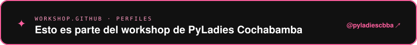

  

### ✦ SOBRE.MÍ

Soy **Lizeth Shirley Amorraga Carvajal**, Desarrollo de Software en Sipe Sipe, Quillacollo, con 0+ años de experiencia. Apasionada, Activa y Participativa

**Skills:** Lenguajes de Programación backend y frontend · Marketing Digital · Arquitectura

  
  
  
  

### ✦ PROYECTOS.DESTACADOS

- **Sistema de Credenciales, ChatBot**

  

✦ ✦ ✦  Diseñado con ♥ y un poco de vibecoding :3 ✨

